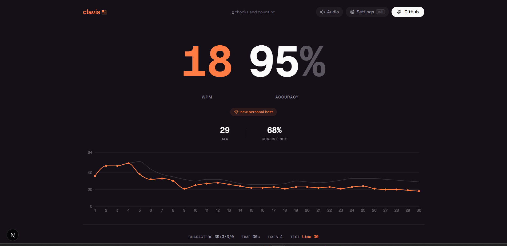
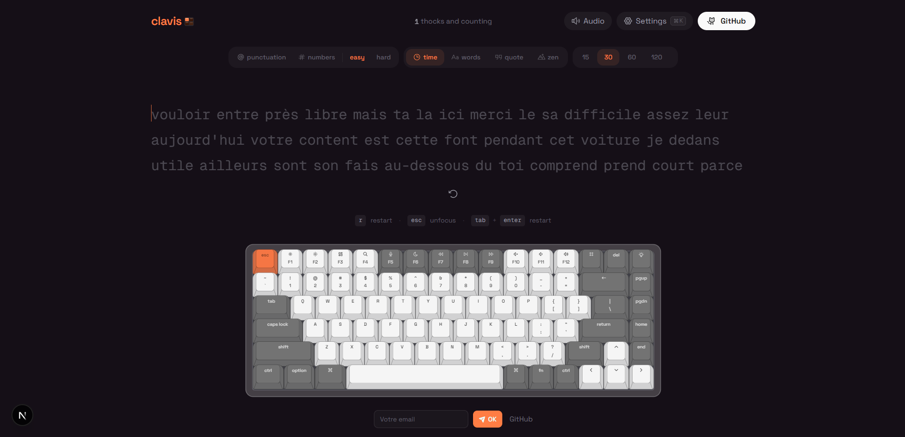

# Clavis ⌨️

**An immersive typing-practice app with mechanical keyboard sounds, live WPM tracking, and multiple practice modes.** Try it at [clavis-azure.vercel.app](https://clavis-azure.vercel.app).

<p align="center">
  
  
</p>

## Features

- Timed, word-count, quote, zen, and progressive learning modes
- French and English interface, with QWERTY, AZERTY, QWERTZ, and BÉPO layouts
- Mechanical keyboard audio, configurable themes, and an interactive virtual keyboard
- WPM, accuracy, consistency, and results export
- Installable PWA with offline support
- Accessibility features including visible focus states and screen-reader announcements

For the best experience, use a desktop or laptop with a physical keyboard.

## Tech stack

Next.js 16 · React 19 · TypeScript · Tailwind CSS · Web Audio API · Serwist · Vitest

## Run locally

Requirements: Bun (recommended) or Node.js 20+.

```bash
 git clone https://github.com/T0b0i7/Clavis.git
 cd Clavis
 bun install
 bun dev
```

Open <http://localhost:3000>. See `package.json` for available scripts.

## License

This repository includes an [Apache License 2.0](./LICENSE). A GitHub star is appreciated, but it is **not** a condition for using the project. Please review the license file before redistributing. Its current copyright notice names Aayush Bharti; verify and correct the attribution only if you own the relevant rights or have authorization.

## Support

If you find Clavis useful, you can [star the repository](https://github.com/T0b0i7/Clavis/stargazers) or [report an issue](https://github.com/T0b0i7/Clavis/issues).
